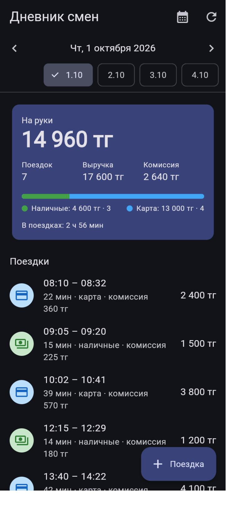
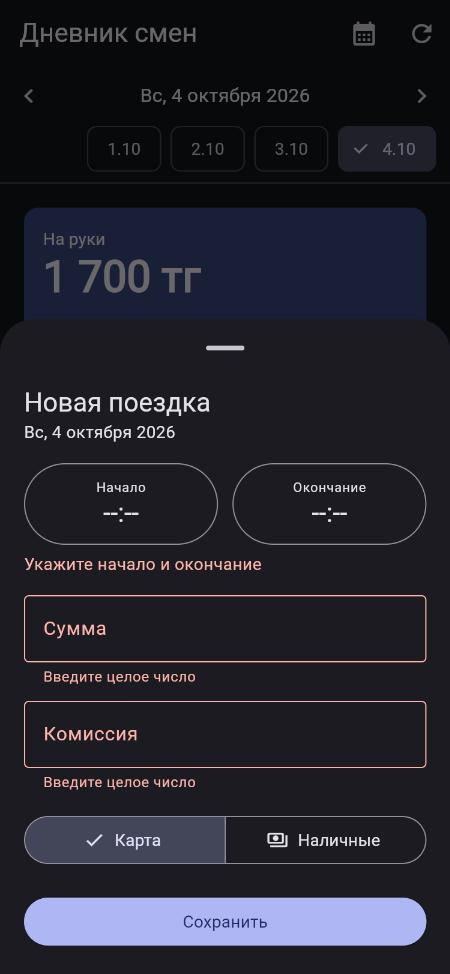
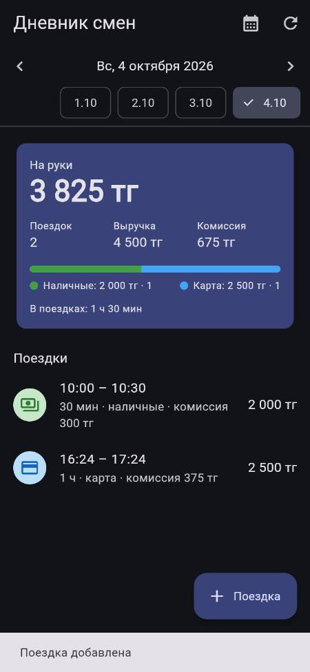

# Дневник смен водителя

Мини-проект: сервер на **Dart (shelf)** отдаёт поездки и сводку за день, клиент на **Flutter**
(Android / Web / Windows) показывает сводку, список поездок, переключает дни и добавляет поездки.

<p>
  
  
  
</p>

## Что сделано

| Требование | Где |
|---|---|
| API: поездки за день + сводка (число поездок, выручка, комиссия, «на руки», наличные/карта) | `GET /api/days/<дата>` — [api.dart](server/lib/src/api.dart), [summary.dart](server/lib/src/summary.dart) |
| Клиент: сводка, список, переключение дней | [day_screen.dart](app/lib/day_screen.dart): стрелки ‹ ›, чипы дней с поездками, календарь |
| Добавление с проверкой (сумма > 0, окончание позже начала) | `POST /api/trips` — [validation.dart](server/lib/src/validation.dart); та же проверка в форме клиента |
| Повторная отправка не создаёт дубль | [trip_store.dart](server/lib/src/trip_store.dart) + id, который клиент создаёт один раз на форму |
| Тесты на сводку и на дубли | [server/test](server/test) — 21 тест, [app/test](app/test) — 2 widget-теста |

## Запуск

Нужен Flutter SDK (в нём есть Dart). Проверено на Flutter 3.47 / Dart 3.13.

```bash
# 1. Сервер — http://localhost:8095
cd server
dart pub get
dart run bin/server.dart

# 2. Клиент (в другом терминале)
cd app
flutter pub get
flutter run -d chrome
```

При первом запуске сервер копирует пример `data/trips.sample.json` (15 поездок за 1–3 октября 2026)
в рабочий `data/trips.json` — туда же сохраняются новые поездки. Чтобы начать заново, удалите `data/trips.json`.

Настройки сервера — переменные окружения: `PORT` (8095), `DATA_FILE` (`data/trips.json`), `TZ_OFFSET` (`+05:00`).

Адрес API для клиента задаётся при сборке:

```bash
flutter run -d chrome --dart-define=API_URL=http://localhost:8095   # по умолчанию
flutter run --dart-define=API_URL=http://10.0.2.2:8095              # эмулятор Android
flutter run --dart-define=API_URL=http://192.168.1.10:8095          # телефон в той же сети (IP компьютера)
```

Тесты:

```bash
cd server && dart test
cd app && flutter test
```

## API

| Метод | Путь | Ответ |
|---|---|---|
| GET | `/api/days` | дни, в которые были поездки: `{"utcOffset":"+05:00","days":[{"date":"2026-10-01","tripCount":7}]}` |
| GET | `/api/days/2026-10-01` | `{"date", "utcOffset", "summary", "trips"}` — пустой день тоже 200 с нулями |
| POST | `/api/trips` | **201** создана · **200** `created:false` — повтор, дубль не создан · **422** ошибки по полям · **409** конфликт |

Сводка:

```json
{"tripCount": 2, "revenue": 3900, "commission": 585, "net": 3315,
 "cash": {"count": 1, "amount": 1500}, "card": {"count": 1, "amount": 2400}, "driveMinutes": 37}
```

`net` («на руки») = выручка − комиссия.

Ошибка валидации — все поля сразу, чтобы форма могла подсветить каждое:

```bash
curl -X POST localhost:8095/api/trips -d '{"id":"x","start":"2026-10-04T11:00:00+05:00","end":"2026-10-04T10:30:00+05:00","amount":0,"payment":"cash","commission":0}'
# 422 {"error":"Ошибка в данных","fields":{"end":"Окончание должно быть позже начала","amount":"Сумма должна быть больше 0"}}
```

## Решения и допущения

**Защита от дублей.** Ключ идемпотентности — `id` поездки. Клиент генерирует его один раз при открытии формы,
поэтому если ответ потерялся и водитель нажал «Сохранить» ещё раз, уходит тот же `id`.
Сервер сравнивает содержимое:
- тот же `id` и те же данные → `200 created:false`, ничего не меняется (повтор считается успехом — клиенту не нужно показывать ошибку);
- тот же `id`, другие данные → `409`, старая запись не перезаписывается;
- другой `id`, но время пересекается с существующей поездкой → `409`. Водитель не может быть в двух поездках сразу,
  и это ловит ту же поездку, отправленную под новым `id`. Стык (конец одной = начало другой) разрешён.

Проверка и вставка идут синхронно, без `await` между ними, поэтому 10 одновременных одинаковых запросов создают одну запись (есть тест).
Сравнение времени — по моменту, а не по строке: `08:10+05:00` и `03:10Z` — одна и та же поездка.

**Часовой пояс.** Поездка относится к дню водителя по времени начала в его часовом поясе (`TZ_OFFSET`, по умолчанию +05:00),
а не по UTC: поездка в 00:20 по Алматы — это 19:20 UTC предыдущего дня. Поездка через полночь считается в день начала.
Время без часового пояса (`2026-10-01T08:10:00`) отклоняется — оно неоднозначно.
Клиент показывает время из строки сервера, а не через `DateTime`, чтобы часовой пояс телефона не сдвигал смену.

**Деньги** — целые числа (тенге), без `double`. Дополнительно проверяется: комиссия ≥ 0 и не больше суммы,
способ оплаты `cash`/`card`, непустой `id`. Комиссия в форме подставляется как 15% от суммы — это видно из примера
(360 от 2400, 225 от 1500) — и её можно изменить.

**Хранение** — JSON-файл, как в условии. Запись через временный файл + rename, чтобы при падении не остался обрезанный JSON;
записи идут строго по очереди. Для одного водителя этого хватает; для нескольких водителей и параллельных
серверов нужна БД с уникальным индексом по `id`.

В примере данных из задания не хватает закрывающей `]` — в `trips.sample.json` формат исправлен.

## Структура

```
server/
  bin/server.dart          запуск HTTP-сервера
  lib/src/trip.dart        модель поездки, часовые пояса
  lib/src/validation.dart  разбор и проверка входящего JSON
  lib/src/summary.dart     расчёт сводки
  lib/src/trip_store.dart  хранилище + защита от дублей
  lib/src/api.dart         маршруты, CORS
  test/                    тесты сводки, дублей, валидации, API
  data/trips.sample.json   пример данных
app/
  lib/api.dart             HTTP-клиент и модели
  lib/day_screen.dart      экран дня: сводка, список, переключение дней
  lib/add_trip_sheet.dart  форма новой поездки
  test/                    widget-тесты на фейковом HTTP-клиенте
```

## Использование ИИ

<!-- TODO: перепишите своими словами -->
Проект сделан с Claude Code: архитектура, код, тесты и README сгенерированы им по моей постановке,
затем приложение запускалось и проверялось в браузере. Что пришлось исправлять по ходу проверки:

- символ ₸ не отображался во Flutter Web (в шрифте по умолчанию нет глифа) — заменён на «тг»;
- «тг» переносился на новую строку отдельно от суммы — неразрывный пробел;
- на маленьком экране кнопка «Сохранить» уходила за край шторки — форма стала прокручиваемой;
- ошибки валидации в форме не исчезали после ввода — включена перепроверка полей при вводе.
